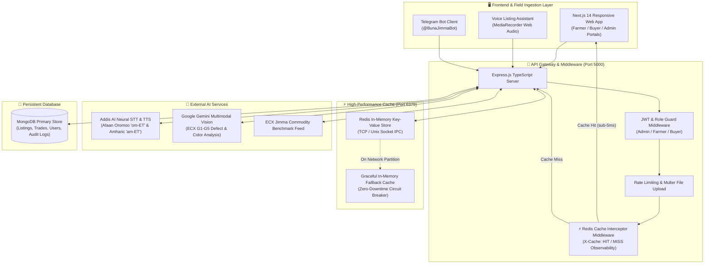
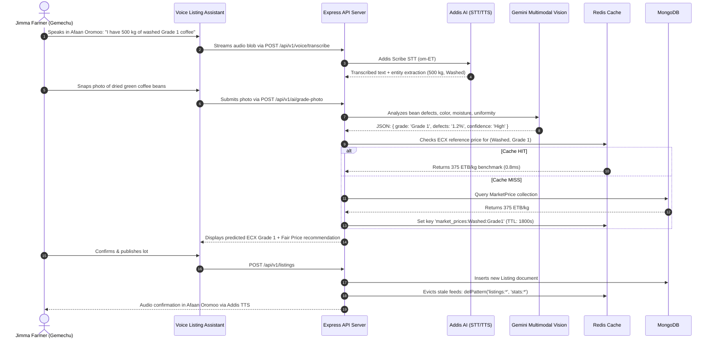
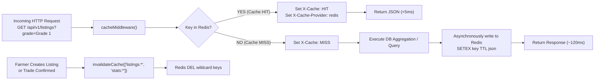

# ☕ GebaBuna (ገባ ቡና) — Buna Fair Price Platform
### AI-Powered Bilingual Voice Commodity Exchange & Multimodal ECX Quality Grading for Jimma Coffee Farmers

[](https://cursor.com)
[](https://www.typescriptlang.org/)
[](https://nextjs.org/)
[](https://nodejs.org/)
[](https://redis.io/)
[](https://www.mongodb.com/)
[](https://ai.google.dev/)
[](https://telegram.org/)

> 🏆 **Developed during the Cursor Hackathon held in Jimma, Ethiopia** — the historical birthplace of Arabica coffee. Built on the ground to directly address the economic challenges faced by Jimma zone smallholders.

---

## 🏆 The Cursor Hackathon — Jimma, Ethiopia

This project was conceived, designed, and built during the **Cursor Hackathon in Jimma, Ethiopia**. Being physically located in Jimma provided our team with direct access to local coffee farmers, cooperatives (such as the Mana and Gomma primary coops), and regional agricultural realities. 

Rather than building a generic marketplace, we engineered GebaBuna specifically for the Jimma coffee belt:
* **Hyper-Localized Dialects**: Deep integration with Afaan Oromoo (the primary language spoken by over 90% of farmers in Jimma zone) and Amharic.
* **ECX Jimma Benchmarks**: Tailored for Jimma Washed & Natural contract tiers (G1 to G5) traded at the regional exchange.
* **Low-Infrastructure Resilience**: Engineered with Redis caching and offline fallback specifically to handle Southwest Ethiopia's intermittent mobile data networks.

---

## 📌 Executive Pitch & The Problem We Solved

In Ethiopia—the biological birthplace of Arabica coffee—over **5 million smallholder farming families** depend on coffee for their livelihoods, with the Jimma and Limmu highland zones standing as global epicenters for specialty heirloom varieties.

Despite cultivating some of the highest-scoring specialty coffees in the world, Jimma smallholders face chronic exploitation:
1. **Predatory Middlemen & Asymmetric Information**: Unregulated brokers withhold current Ethiopian Commodity Exchange (ECX) benchmark prices, buying high-grade coffee for pennies and capturing up to **40–60% margins** at the farmer's expense.
2. **Subjective Quality Downgrading**: Visual bean grading is done manually and opaquely by local aggregators. Farmers have no means to objectively prove that their lot is ECX Grade 1 or 2, forcing them to accept lower Grade 4/5 pricing.
3. **Severe Literacy & Language Barriers**: Most rural farmers speak **Afaan Oromoo** or **Amharic** and cannot navigate dense English web portals, complex paperwork, or digital keyboards.
4. **High Network Latency & Rural Bandwidth Limitations**: Fragile rural connectivity in Southwestern Ethiopia causes standard web applications to timeout or fail under real-world usage.

### 💡 The Solution: GebaBuna (ገባ ቡና)
**GebaBuna** is a fullstack commodity marketplace and AI grading platform designed specifically for Ethiopian smallholders:
- 🎙️ **Voice-First AI Agent**: Low-literacy farmers speak directly in native **Afaan Oromoo (`om`)** or **Amharic (`am`)** using conversational AI powered by Addis AI Neural Voice & Gemini.
- 🔬 **Multimodal Computer Vision Grading**: Farmers snap a bean photo; Google Gemini Vision analyzes defects, bean color, moisture, and uniformity, automatically predicting the official ECX Grade tier (G1–G5).
- ⚖️ **Real-Time ECX Price Fairness Engine**: Every listing is evaluated in real time against current ECX contract prices with visual fairness indicators (*Fair, Below Market, Above Premium*).
- ⚡ **High-Speed Redis Caching Layer**: Critical market prices, public aggregated stats, and filtered marketplace feeds are cached in Redis with sub-5ms response times, proactive write-through invalidation, and a fault-tolerant in-memory fallback.
- 🤝 **Double-Sided Verification & Anti-Fraud**: Strict cooperative union and exporter vetting, paired with a two-step handshake (delivery confirmed + payment confirmed) before funds are settled.
- 📱 **Omnichannel Field Access**: Complete Next.js 14 web platform + native Telegram Bot (`BunaJimmaBot`) operating over low-bandwidth 2G/3G connections.

---

## 🏛️ System Architecture



---

## 🔄 Core User Flow: Voice-to-Marketplace Coffee Lot



---

## ⚡ Redis In-Memory Caching Architecture

To guarantee high availability and instant responsiveness even under intermittent rural connectivity, we implemented an enterprise-grade Redis caching layer with full observability and fault isolation.



### Key Engineering Features of the Redis Implementation:
1. **Dynamic Wildcard Eviction (`delPattern`)**:
   - Write mutations (`POST /listings`, `PUT /listings/:id`, trade delivery/payment confirmations) trigger surgical wildcard pattern invalidations across `listings:*`, `listing_detail:*`, and `stats:*`.
2. **Resilient Circuit-Breaker with In-Memory Fallback**:
   - Built on `ioredis` with an automated fallback to an internal `MemoryStore`. If the Redis daemon experiences network lag or disconnects, the platform **never throws 500 errors or drops requests**—it seamlessly switches to in-memory caching and recovers when Redis reconnects.
3. **HTTP Header Observability**:
   - Every cached endpoint exposes transparent debugging headers:
     - `X-Cache: HIT` / `X-Cache: MISS` / `X-Cache: BYPASS`
     - `X-Cache-Provider: redis` (or `memory-fallback`)
     - `X-Cache-Key: <namespace>:<serialized-route>`
4. **Cache Bypass Support**:
   - Clients can pass `Cache-Control: no-cache` for real-time polling requirements or automated testing.
5. **Live Telemetry Endpoint**:
   - Inspect cache health, hit ratios, and key counts at runtime via `GET /api/v1/health` or `GET /api/v1/health/cache`.

### Cached Endpoints & Expiry Policy:
| Endpoint | Cache Prefix | Default TTL | Invalidation Triggers |
| :--- | :--- | :--- | :--- |
| `GET /api/v1/market-prices` | `market_prices` | 30 minutes (1800s) | Admin price update, live ECX sync |
| `GET /api/v1/market-prices/history` | `market_prices_history` | 30 minutes (1800s) | Admin price update |
| `GET /api/v1/stats/public` | `stats` | 60 seconds | New listing, completed trade settlement |
| `GET /api/v1/listings` (with filters) | `listings` | 60 seconds | New listing created, updated, or cancelled |
| `GET /api/v1/listings/:id` | `listing_detail` | 60 seconds | Status update, AI grading hook |
| `GET /api/v1/leaderboard/farmers` | `leaderboard_farmers` | 5 minutes (300s) | Trade settled, buyer rating submitted |
| `GET /api/v1/leaderboard/buyers` | `leaderboard_buyers` | 5 minutes (300s) | Trade settled, farmer review submitted |

---

## 🔬 Multimodal Coffee Grading Engine

Traditional grading relies on subjective human inspectors. GebaBuna introduces an automated multimodal grading pipeline powered by Google Gemini Vision:

| Evaluated Metric | Measurement & Standards | Technical Impact |
| :--- | :--- | :--- |
| **ECX Grade Tier** | Washed & Natural Grade 1 through Grade 5 | Translates directly into official market pricing tiers |
| **Defect Percentage** | Black beans, broken beans, insect perforation, foreign debris | Provides clear percentage threshold mapping |
| **Color Quality** | Dark bluish-green, green, yellowish, or brown | Distinguishes fresh harvest from aged or over-fermented beans |
| **Uniformity Score** | 1 to 10 scale | Evaluates screen size consistency |
| **Moisture Estimate** | Ideal export range: 9.5% – 11.5% | Warns against mold hazard or over-drying weight loss |
| **Actionable Advice** | Bilingual sorting recommendations in Afaan Oromoo & Amharic | Teaches farmers how to elevate Grade 3 coffee to Grade 1 |

---

## 🚀 Quick Start Guide

### Prerequisites
- **Node.js** >= 18.x
- **MongoDB** >= 6.x
- **Redis Server** >= 7.x (Optional — runs with automatic in-memory fallback if not installed)
- **Python** >= 3.10 (for Telegram Bot & standalone grader)

### 1. Clone & Install Dependencies
```bash
git clone https://github.com/your-username/GebaBuna.git
cd GebaBuna

# Install backend dependencies
cd server && npm install

# Install frontend dependencies
cd ../client && npm install
cd ..
```

### 2. Configure Environment Variables
Copy `.env.example` to `.env` in the root and server folders:
```bash
cp .env.example .env
cp .env.example server/.env
cp .env.example client/.env.local
```

### 3. Seed Mock Data (Jimma Farmers, Buyers, ECX Prices)
```bash
cd server
npm run seed
cd ..
```

### 4. Run the Fullstack Application
Start MongoDB, Redis, Express Backend, and Next.js Frontend with one unified launcher:
```bash
chmod +x start_fullstack.sh
./start_fullstack.sh
```

Or start services independently:
```bash
# Terminal 1: Redis Server
redis-server --port 6379

# Terminal 2: Express Server (Port 5000)
cd server && npm run dev

# Terminal 3: Next.js Client (Port 3000)
cd client && npm run dev

# Terminal 4 (Optional): Telegram Bot
python run_bot.py
```

### 5. Verify the Redis Caching Layer
Run the dedicated Redis cache test suite:
```bash
cd server
npm run test:cache
```
Inspect cache headers with `curl`:
```bash
# 1st request (Cache MISS)
curl -i http://localhost:5000/api/v1/market-prices

# 2nd request (Cache HIT from Redis)
curl -i http://localhost:5000/api/v1/market-prices

# Inspect cache telemetry
curl http://localhost:5000/api/v1/health/cache
```

---

## 🔑 Demo Accounts & Pre-Seeded Roles

For testing and live evaluation, the database includes pre-configured personas:

| Role | Name & Affiliation | Login Phone / Email | Password / OTP | Key Capabilities |
| :--- | :--- | :--- | :--- | :--- |
| **Admin** | Dr. Getachew Zeleke *(Jimma Agriculture Bureau)* | `admin@jimma-agri.gov.et` | `admin123456` | Verify buyers, inspect audit logs, update ECX reference benchmarks |
| **Farmer** | Gemechu Daba *(Mana Woreda, Kenteri)* | `+251917112233` / `gemechu@buna.et` | `123456` (OTP) or `farmer123456` | Voice listing creation, AI bean grading, incoming offer acceptance |
| **Farmer** | Chaltu Tolosa *(Gomma Woreda, Beshasha)* | `+251917223344` / `chaltu@buna.et` | `123456` (OTP) or `farmer123456` | Specialty micro-lot management, trade delivery confirmation |
| **Buyer** | Dejene Dadi *(Oromia Coffee Farmers Coop Union)* | `+251911100001` / `dejene@oromia-union.com` | `123456` (OTP) or `buyer123456` | Verified buyer, browse marketplace, negotiate offers, confirm payments |
| **Buyer** | Sara Haile *(Jimma Highland Exporters PLC)* | `+251911100002` / `sara@jimmaspecialty.com` | `123456` (OTP) or `buyer123456` | Verified exporter, contract negotiation, generate trade report cards |

---

## 📁 Repository Directory Structure

```text
GebaBuna/
├── .env.example              # Centralized environment reference
├── start_fullstack.sh        # Production & demo bootstrapper (MongoDB + Redis + Node + Next)
├── IMPLEMENTATION_PROGRESS.md# Feature audit & implementation log
│
├── client/                   # Next.js 14 Frontend Application
│   ├── src/
│   │   ├── app/              # App router pages (marketplace, farmer, buyer, admin, leaderboard)
│   │   ├── components/       # UI components (VoiceListingAssistant, AIAnalysisModal, etc.)
│   │   ├── context/          # LanguageContext (om/am/en), AuthContext
│   │   ├── services/         # Client API client with Axios
│   │   └── utils/            # Audio recorder & ECX price calculators
│   └── package.json
│
├── server/                   # Express TypeScript Backend REST API
│   ├── src/
│   │   ├── config/           # DB connection, Redis config & environment variables
│   │   ├── constants/        # ECX Coffee price benchmarks & grade tables
│   │   ├── middleware/       # cacheMiddleware, authMiddleware, uploadMiddleware
│   │   ├── models/           # Mongoose schemas (Listing, Trade, Offer, MarketPrice, User)
│   │   ├── routes/           # Versioned REST endpoints (/api/v1/*)
│   │   ├── services/         # redisService, addisAiService, coffeeGraderService, scoringService
│   │   ├── tests/            # Automated cache & service test suites
│   │   ├── index.ts          # Express application entrypoint
│   │   └── seed.ts           # Jimma regional seed data generator
│   └── package.json
│
└── buna-fair-price/          # Python AI Grader & Telegram Bot
    ├── bot/                  # Telegram handlers, localization (Afaan Oromoo/Amharic)
    ├── grader/               # Standalone Python Gemini vision grader
    └── run_bot.py            # Telegram bot launcher
```

---

## 🏆 Engineering Highlights for Technical Recruiters

- **Full-Stack Proficiency**: Seamless bridge between modern Next.js 14 client, performant Express TypeScript REST API, and asynchronous Python bot agents.
- **Microsecond Latency Optimization**: Redis cache abstraction providing `X-Cache` transparency, atomic pattern invalidation, and custom memory fallback.
- **Production-Grade Resilience**: Zero single-point-of-failure design; graceful fallback to in-memory caching when Redis is cold, and multiple Gemini fallback API keys with automatic tier retry (`gemini-3.7-flash` -> `gemini-flash-lite`).
- **Human-Centered AI (AI for Good)**: Leveraging cutting-edge multimodal vision and local Ethiopian language speech models (Addis AI) to dismantle generational financial inequality for rural smallholder farmers.
- **Enterprise Verification Security**: Role-based access control (RBAC), JWT sessions, rate limiting, and immutable administrative audit logs.
